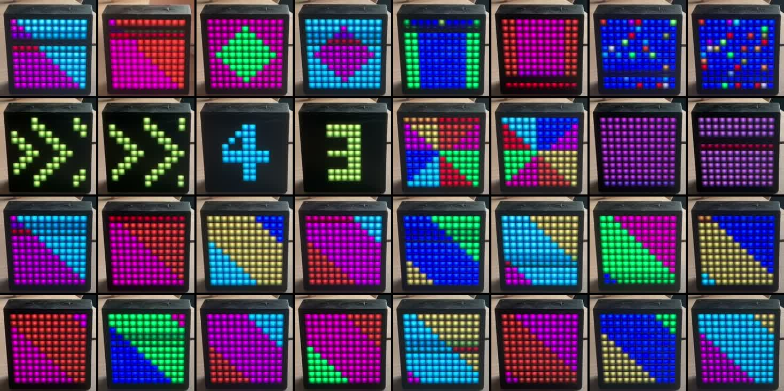
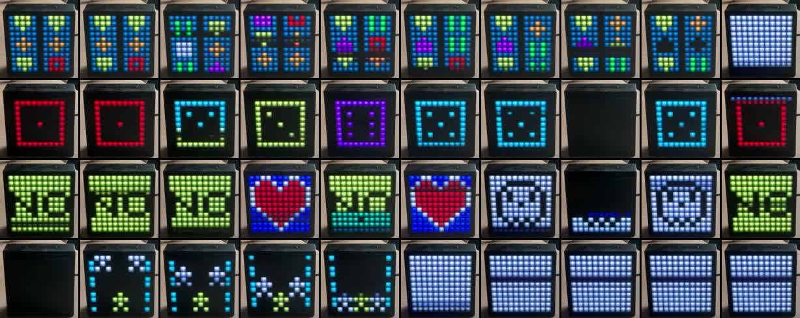

# TimeBox-mini, reprogrammed

Draw on, animate and control a **Divoom TimeBox-mini** (the 11×11 LED Bluetooth speaker)
from a Mac, without the Divoom app. This repo has:

- **`tb`**, a small command line tool in Swift that talks to the box over Bluetooth
- **a pixel art editor** in the browser that draws and animates straight onto the box
- **[PROTOCOL.md](PROTOCOL.md)**, everything we found out about the box's protocol, including
  parts no earlier project documents
- the scripts and the camera method used to find it all



## Quick start

You need a Mac with the Xcode command line tools (`xcode-select --install`).

1. Switch the box on and pair it in System Settings › Bluetooth (it shows up as
   `TimeBox-mini-audio`).
2. Build: `./build.sh`
3. Try it: `./tb selftest`, then `./tb clock 24 00ff00` for a green clock.

The first time `tb` uses Bluetooth, macOS asks whether your terminal may use it. Allow it in
System Settings › Privacy & Security › Bluetooth.

`tb` finds the box by name among your paired devices. If you have more than one, pass
`--addr XX:XX:XX:XX:XX:XX` or set `TB_ADDR`. Only one program can talk to the box at a time.

## The pixel editor

```
./tb serve
```

Then open http://127.0.0.1:8765. Draw with 16 swatches or any colour (shown as the box's
4-bit colour), build up to 12 animation frames with their own timing, and press **Play on
TimeBox**. With **Live** on, every stroke shows up on the box as you draw. The editor also
sets brightness, lamp colour, clock colour, effects and visualisers. Drawings are saved in
the browser. `./tb serve --dry` runs the editor without touching Bluetooth.

## Commands

| Command | What it does |
|---|---|
| `tb clock [12\|24] [RRGGBB]` | Clock, optionally in a colour |
| `tb temp [c\|f] [RRGGBB]` | Temperature |
| `tb light RRGGBB [0-100]` / `tb off` | Use the screen as a lamp / switch it dark |
| `tb brightness 0-100` | Display brightness |
| `tb effect 0-7` / `tb viz 0-6` | Built-in effects / music visualisers |
| `tb stopwatch` / `tb score RED BLUE` | Stopwatch / scoreboard |
| `tb game 0-5` | Play a built-in game from the keyboard: arrows, space = go, return = ok, q = quit |
| `tb time` | Set the box's clock to the Mac's |
| `tb volume 0-15` | Speaker volume |
| `tb getview` | Read the box's state |
| `tb fill R G B` / `tb test` | Fill the screen / draw a gradient |
| `tb anim [delay]` | A test animation |
| `tb raw <hex>` | Send any command: command byte, then data. `tb raw 45 00 01` = 24 h clock |
| `tb scan [options]` | Send command bytes one by one and log what answers (see below) |
| `tb sdp` | List the box's Bluetooth services |

## Can it run games?

Yes, six of them: a slot machine, dice, a magic 8-ball, catching falling stars, picture
scenes and a falling-blocks stacking game. The catch, which no earlier project mentions, is
that a game only runs while the connection stays open: the box quits the game the moment
you disconnect. `tb game N` keeps the connection open and turns your keyboard into the
controller.



**Never start game 6 or higher.** Trying 6 to 9 froze our box: it stopped answering over
Bluetooth and its buttons stopped working (`docs/games-3-9-freeze.jpg` shows it getting stuck
on game 5). `tb game` refuses those numbers unless you add `--force`.

## How it was reverse engineered

The box has no published API, so the work went in this order.

**1. Read what others found.** Several community projects had already worked out parts of the
protocol for this box and its bigger siblings (credited below). Their notes disagree in
places and none were checked on every point, so they were treated as leads, not facts.

**2. Find the right channel.** `tb sdp` lists the box's Bluetooth services. The display
listens on RFCOMM channel 4 ("Serial Port 1"); channel 1 is the hands-free audio.

**3. Get one frame byte-perfect.** `tb selftest` builds the community doc's example frame and
compares it byte for byte. That fixed the framing: start and end bytes, the length, the
checksum and the escaping of `01`, `02` and `03`.

**4. Test by watching.** Each command was sent with a numbered label while a person watched
the box. Single-pixel walks across the screen and per-channel colour ramps confirmed the
pixel order and the 4-bit colour packing.

**5. Test with a camera.** Eyes are bad at timing, so the Mac's FaceTime camera filmed the
box while scripts drove it. Each run starts with a **sync flash**: the script turns the
screen white and logs the exact moment it sent that command. Finding the first white frame
in the video lines the video up with the script's clock to within one camera frame
(33 ms). From there every logged command can be matched to what the screen did.

This caught a real mistake. By eye, blank padding frames in an animation seemed to be
skipped. On camera they showed as 1.6 s of black. The camera also measured the exact frame
timing ((delay + 1) × 100 ms, 200 ms at least) and the ~75 ms delay before an animation
starts. `scripts/film-steps.sh` and `camera/sheet.py` turn any list of commands into a
labelled contact sheet like the pictures in this README.

**6. Diff the state.** The box answers command `46` with 23 bytes of state. Changing one
setting at a time and diffing the reply (`scripts/state-diff.sh`) decoded 16 of the 23
bytes. `scripts/range-test.sh` showed that the box stores any effect number without
clamping.

**7. Scan every command.** `tb scan` sends all 256 command bytes with no data, logs every
reply and the state after each, and films the box at the same time
(`scripts/film-scan.sh`). About 50 commands answered. Many had never been documented: the
battery voltage, the alarm and reminder lists, version information and the firmware update
URL among them. [PROTOCOL.md](PROTOCOL.md) lists them all.

**8. Try the games.** The game commands came from a driver for Divoom's bigger boxes. On the
mini they seemed to do nothing until it turned out the connection has to stay open.
Filming them identified each game.

## What this adds to earlier work

- The exact animation timing, that the box always loops all 12 frame slots, and that blank
  frames are not skipped, plus a slot-filling method that keeps a loop's timing.
- A decode of 16 of the 23 state bytes.
- The number and look of the effects (8) and visualisers (7), filmed.
- That stopwatch and scoreboard are not stored as the current view, and that brightness is
  answered as command `32`.
- The six games on the mini, that they need a held connection, and that numbers above 5
  can freeze the box.
- A full scan of all 256 command bytes, with every reply.
- A camera method that measures what the box does instead of guessing.

## Warnings

- **A scan with no data can change settings.** Some commands seem to read the frame's
  checksum as their argument when none is sent. After our scan the box's own buttons no
  longer worked as before.
- **Game numbers above 5 can freeze the box.** Ours stopped responding to Bluetooth and its
  buttons. If yours does, let the battery run flat or open the case and unplug the battery
  for a few seconds.
- `tb` never writes alarms, reminders or firmware settings, and the scan's raw logs are not
  published because they contain the owner's alarms and reminders.

## Files

| Path | What it is |
|---|---|
| `main.swift` | Framing, images, animations and most commands |
| `server.swift` | `tb serve`: the local web server behind the editor |
| `editor.html` | The pixel art editor |
| `scan.swift` | `tb scan` |
| `game.swift` | `tb game` |
| `scripts/` | Probing, state diffing, range tests and the camera recording scripts |
| `camera/sheet.py` | Turns a camera recording into a labelled contact sheet |
| `docs/` | Camera contact sheets of effects, visualisers and games |

## Credits

Built on the work of
[MarcG046/timebox](https://github.com/MarcG046/timebox) (protocol draft),
[d03n3rfr1tz3/hass-divoom](https://github.com/d03n3rfr1tz3/hass-divoom) (game and many other commands),
[ScR4tCh/timebox](https://github.com/ScR4tCh/timebox),
[mathoudebine/homeassistant-timebox-mini](https://github.com/mathoudebine/homeassistant-timebox-mini),
[jbfuzier/timeboxmini](https://github.com/jbfuzier/timeboxmini),
[RomRider/node-divoom-timebox-evo](https://github.com/RomRider/node-divoom-timebox-evo),
[derHeinz/divoom-adapter](https://github.com/derHeinz/divoom-adapter) and
[spezifisch/divo](https://github.com/spezifisch/divo).

Not affiliated with Divoom. Made by Louis Nordbø with Claude. MIT licence.
